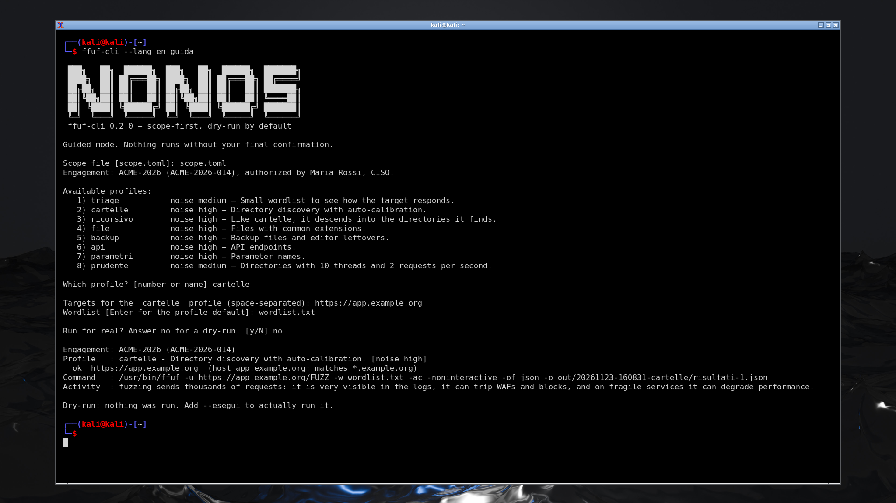
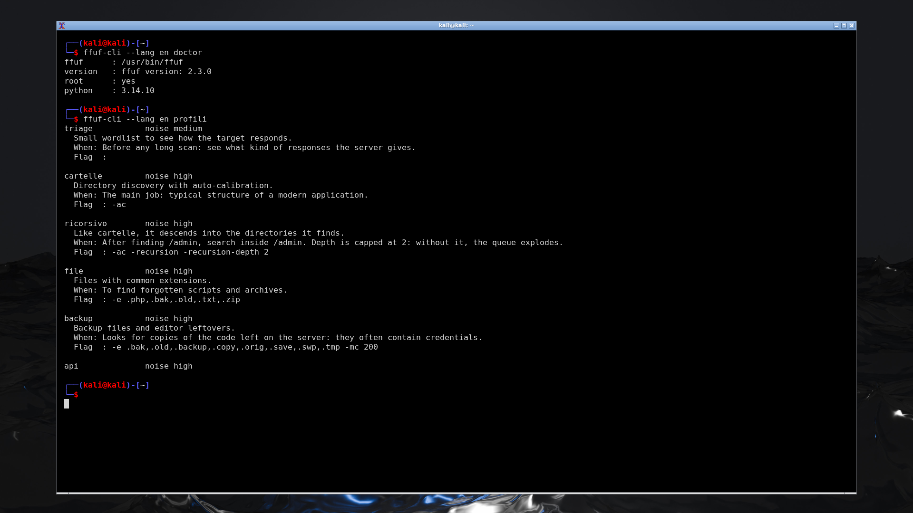
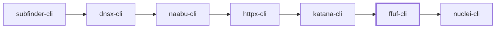

# ffuf-cli

🌐 [Italiano](README.md) · **English** · [中文](README.zh.md)

[](https://github.com/NON-OS/ffuf-cli/actions/workflows/ci.yml)


```
  ┌─ scope ─┐   ┌─ dry-run ─┐   ┌─ confirm ─┐   ┌─ ffuf ─┐   ┌─ audit ─┐   ┌─ report ─┐
  │ check   │ → │ show      │ → │ ticket    │ → │ runs    │ → │ chain   │ → │ summary  │
  └─────────┘   └───────────┘   └───────────┘   └─────────┘   └─────────┘   └──────────┘
```

Web path fuzzing with a validated scope, dry-run by default and a hash-chained audit. Authorized targets only.

> **Only systems you own or have written authorization for.** Read [DISCLAIMER.md](DISCLAIMER.md) before you launch anything.

## What it is

`ffuf-cli` is a thin orchestrator around ffuf. It does not replace it. It checks that the host is in scope, builds the URL from the profile (you do not write it yourself), and limits the tool to content discovery: paths, files, endpoints, parameters.

ffuf is a general-purpose fuzzer: with `-d` and `-X POST` it becomes a credential brute-forcing tool, and with `-mode clusterbomb` it tries every combination. Those are activities with their own rules of engagement (account lockouts, thresholds, time windows) that you do not improvise with a flag. This wrapper leaves them out: `-d`, `-data`, `-X` and `-mode` are forbidden. What remains still needs a wordlist, and the only way to know how big it is is to count it first.

## In action



*Guided mode (`ffuf-cli guida`) running on Kali Linux: logo, profile selection, scope validation, command preview. Real screenshot.*

```console
$ ffuf-cli --lang en lancia prudente https://app.example.org --scope scope.toml
Engagement: ACME-2026 (ACME-2026-014)
Profile   : prudente - Directories with 10 threads and 2 requests per second. [noise medium]
  ok  https://app.example.org  (host app.example.org: matches app.example.org)
Command   : ffuf -u https://app.example.org/FUZZ -w /usr/share/seclists/Discovery/Web-Content/raft-medium-directories.txt -ac -t 10 -rate 2 -noninteractive -of json -o out/esempio/risultati-1.json
Activity  : fuzzing sends thousands of requests: it is very visible in the logs, it can trip WAFs and blocks, and on fragile services it can degrade performance.

Dry-run: nothing was run. Add --esegui to actually run it.
```

With an out-of-scope target, even among valid ones, nothing runs:

```console
$ ffuf-cli --lang en lancia prudente https://app.example.org https://evil.example --scope scope.toml
ffuf-cli: targets out of scope, running nothing:
  https://evil.example: host evil.example: hostname not among the included ones
$ echo $?
3
```

The `lancia` command never runs without `--esegui`. What you see above is a preview.

The output follows the language you pick: `--lang it|en|zh` or the `NONOS_LANG` variable (handy for setting it system-wide). It always starts in Italian.

## What it does

| | |
|---|---|
| Scope | Domain, host or URL (`url` mode), with exclusions and validity dates. When in doubt, it refuses. |
| Dry-run | By default nothing runs. `--esegui` asks for confirmation. |
| Profiles | 8, each marked with its noise level and when to use it. |
| Flag filter | Flags that bypass the scope or seize control of the output are blocked. |
| List filter | `filtra` reads a list from stdin and lets through only what is in scope. |
| Signed scope | The client signs the scope with their SSH key. If the file changes after signing, nothing runs. |
| Audit | Hash-chained log. Scope hash and signer included, sensitive values masked. |
| Report | Summary of results as text, Markdown or JSON. |
| Diff | What changed between two runs, with an exit code for CI. |
| Dependencies | None: just the Python standard library. |

## Platform

Built for **Kali**, **Parrot** and Linux in general: that is where these tools live and where `ffuf-cli` gets used. It also runs on macOS. Windows is untested, and there some privilege checks (`os.geteuid`) do not apply.

## Installation

You need Python 3.11 or newer and ffuf on your `PATH`. Kali/Debian: sudo apt install ffuf. macOS: brew install ffuf. Anywhere with Go: go install github.com/ffuf/ffuf/v2@latest

```sh
git clone git@github.com:NON-OS/ffuf-cli.git
cd ffuf-cli
python3 -m venv .venv && . .venv/bin/activate
pip install -e .
ffuf-cli doctor
```

## First use

### The simplest way: guided mode

`ffuf-cli guida` asks you one question at a time — scope, profile, target — shows the command preview, and launches nothing without your final confirmation. It is the recommended way to start:

```sh
ffuf-cli guida
```

### Or by command

```sh
ffuf-cli init scope.toml          # crea il modello
$EDITOR scope.toml               # compilalo con il cliente
ffuf-cli verifica https://app.example.org --scope scope.toml
ffuf-cli lancia prudente https://app.example.org --scope scope.toml            # dry-run
ffuf-cli lancia prudente https://app.example.org --scope scope.toml --esegui   # parte davvero
```

In a terminal, `--esegui` asks you to type the engagement ticket. In a script, use `--conferma`. Other ffuf flags go after `--`, unless they are among the forbidden ones ([docs/04-profili.md](docs/en/04-profili.md)).

A full flow:

```sh
ffuf-cli lancia prudente https://app.example.org --scope scope.toml --wordlist ~/wordlist.txt --esegui
ffuf-cli rapporto out/*-prudente/
```

## Commands

| Command | What it does |
|---|---|
| `guida` | step-by-step interactive mode: scope → profile → target → confirmation |
| `lancia <profilo> <target...>` | validates and builds (or runs) ffuf. With `-` it reads targets from stdin |
| `filtra` | reads targets from stdin and prints only those in scope |
| `verifica <target...>` | tells you whether the targets are in scope, without launching |
| `scope-firma <file>` / `scope-verifica <file>` | signs and checks the scope with an SSH key |
| `rapporto <file_or_dir>` | summary of results: paths found |
| `confronta <old> <new>` | differences between two runs |
| `profili` | lists the profiles with their exact flags |
| `audit [file]` | verifies the log's hash chain |
| `init [file]` | creates a scope file to fill in |
| `doctor` | checks ffuf, version, privileges |

## Profiles

| Profile | What it does | Noise | Root |
|---|---|---|---|
| `triage` | Small wordlist to see how the target responds. | medium | no |
| `cartelle` | Directory discovery with auto-calibration. | high | no |
| `ricorsivo` | Like cartelle, it descends into the directories it finds. | high | no |
| `file` | Files with common extensions. | high | no |
| `backup` | Backup files and editor leftovers. | high | no |
| `api` | API endpoints. | high | no |
| `parametri` | Parameter names. | high | no |
| `prudente` | Directories with 10 threads and 2 requests per second. | medium | no |



*`ffuf-cli doctor` (finds the real ffuf binary in `/usr/bin/`) and the profile list, on Kali Linux.*

## Exit codes

| Code | Meaning |
|---|---|
| 0 | all good |
| 1 | `confronta --exit-code` found differences |
| 2 | wrong arguments or a forbidden flag |
| 3 | at least one target out of scope |
| 4 | scope unreadable, malformed or expired |
| 5 | ffuf missing |
| 6 | run without confirmation, or a profile that needs root without sudo |
| 7 | ffuf exited with an error, or the audit chain is broken |

## The tool chain

This repository is one of eight, designed to work together. Each one checks the scope on its own.



- [subfinder-cli](https://github.com/NON-OS/subfinder-cli): subdomain enumeration
- [dnsx-cli](https://github.com/NON-OS/dnsx-cli): dns resolution
- [naabu-cli](https://github.com/NON-OS/naabu-cli): port scanning
- [httpx-cli](https://github.com/NON-OS/httpx-cli): http probes
- [katana-cli](https://github.com/NON-OS/katana-cli): web crawling
- [nuclei-cli](https://github.com/NON-OS/nuclei-cli): vulnerability scanning
- [nmap-cli](https://github.com/NON-OS/nmap-cli): port and service scanning with nmap

## Documentation

1. [Introduction and philosophy](docs/en/01-introduzione.md)
2. [Authorization: what you need before touching a target](docs/en/02-autorizzazione.md)
3. [The scope file](docs/en/03-scope.md)
4. [Profiles and forbidden flags](docs/en/04-profili.md)
5. [The audit log](docs/en/05-audit.md)
6. [Architecture](docs/en/06-architettura.md)
7. [Where to try it safely](docs/en/07-lab.md)
8. [Reports and diffs](docs/en/08-rapporti.md)
9. [Signed scope](docs/en/09-firma.md)
10. [Compatibility and testing](docs/en/10-compatibilita.md)

The shell cheatsheet the project grew out of is in [scripts/](scripts/).

## What it does not do

It does not find out whether you have permission: you declare that in the scope file, and the program takes your word for it. It does not protect against anyone who runs `ffuf` directly. The flag filter is a safety net against mistakes, not a sandbox. The details are in [docs/06-architettura.md](docs/en/06-architettura.md).

## Development

```sh
make check     # ruff (lint + format), mypy --strict, test e coverage
```

No runtime dependencies (just the standard library). Development tools install with `pip install -e ".[dev]"`. See [CONTRIBUTING.md](CONTRIBUTING.md) and [SECURITY.md](SECURITY.md).

## License

MIT, see [LICENSE](LICENSE). The license covers the code; it does not authorize any activity.
