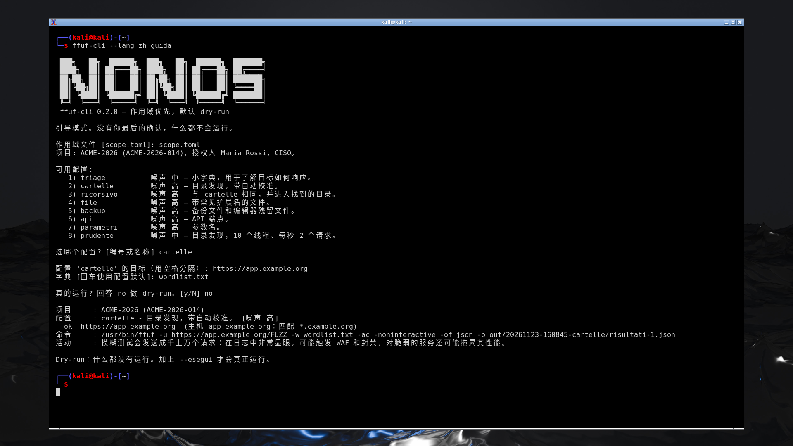
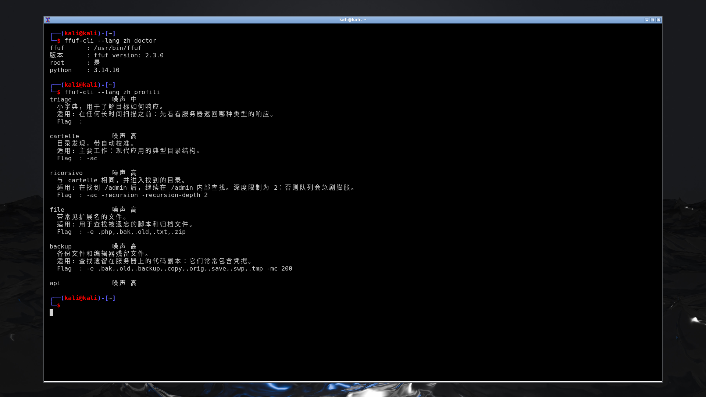
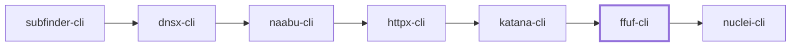

# ffuf-cli

🌐 [Italiano](README.md) · [English](README.en.md) · **中文**

> ⚠️ 本页为机器翻译草稿，正式发布前需母语者校对。

[](https://github.com/NON-OS/ffuf-cli/actions/workflows/ci.yml)


```
  ┌─ 作用域 ─┐   ┌─ dry-run ─┐   ┌─ 确认 ─┐   ┌─ ffuf ─┐   ┌─ 审计 ─┐   ┌─ 报告 ─┐
  │ 校验     │ → │ 显示      │ → │ 工单   │ → │ 运行       │ → │ 哈希链 │ → │ 汇总   │
  └──────────┘   └───────────┘   └────────┘   └────────────┘   └────────┘   └────────┘
```

Web 路径模糊测试，带作用域校验、默认 dry-run 以及哈希链审计。仅限已授权的目标。

> **仅限你自己拥有、或已获得书面授权的系统。** 运行任何操作之前，请先阅读 [DISCLAIMER.md](DISCLAIMER.md)。

## 这是什么

`ffuf-cli` 是围绕 ffuf 的一层薄封装。它不是它的替代品。它检查主机是否在作用域内，由配置来构建 URL（而不是你自己写），并把这个工具限制在内容发现上：路径、文件、端点、参数。

ffuf 是个通用的模糊测试工具：配上 `-d` 和 `-X POST`，它就变成了凭据爆破工具；配上 `-mode clusterbomb`，它会尝试所有组合。这些都是有自己项目规则（账户锁定、阈值、时间窗口）的活动，不是靠一个标志就能即兴开展的。本封装把它们排除在外：`-d`、`-data`、`-X`、`-mode` 都被禁用。而对于剩下的功能，仍然需要一份字典，而唯一能知道它有多大的办法，就是事先数一数。

## 实际效果



*引导模式（`ffuf-cli guida`）在 Kali Linux 上运行：logo、配置选择、作用域校验、命令预览。真实截图。*

```console
$ ffuf-cli --lang zh lancia prudente https://app.example.org --scope scope.toml
项目     : ACME-2026 (ACME-2026-014)
配置     : prudente - 目录发现，10 个线程、每秒 2 个请求。 [噪声 中]
  ok  https://app.example.org  (主机 app.example.org：匹配 app.example.org)
命令     : ffuf -u https://app.example.org/FUZZ -w /usr/share/seclists/Discovery/Web-Content/raft-medium-directories.txt -ac -t 10 -rate 2 -noninteractive -of json -o out/esempio/risultati-1.json
活动     : 模糊测试会发送成千上万个请求：在日志中非常显眼，可能触发 WAF 和封禁，对脆弱的服务还可能拖累其性能。

Dry-run：什么都没有运行。加上 --esegui 才会真正运行。
```

只要有一个目标超出作用域，即使混在合法目标中，也什么都不会运行：

```console
$ ffuf-cli --lang zh lancia prudente https://app.example.org https://evil.example --scope scope.toml
ffuf-cli: 目标超出作用域，不运行任何东西：
  https://evil.example: 主机 evil.example：主机名不在包含列表中
$ echo $?
3
```

`lancia` 命令在没有 `--esegui` 的情况下绝不会真正运行。你在上面看到的只是一份预览。

输出语言由你选择：`--lang it|en|zh` 或环境变量 `NONOS_LANG`（适合全系统设置）。默认总是意大利语。

## 功能一览

| | |
|---|---|
| 作用域 | 域名、主机或 URL（`url` 模式），支持排除项与有效期。有疑问时一律拒绝。 |
| Dry-run | 默认不执行任何操作。`--esegui` 会要求确认。 |
| 配置 | 8，并标明噪声级别和适用场景。 |
| 标志过滤 | 凡是会绕过作用域、或夺走输出控制权的标志，都会被拦截。 |
| 列表过滤 | `filtra` 从 stdin 读取一份列表，只放行作用域内的条目。 |
| 签名作用域 | 客户用自己的 SSH 密钥为作用域签名。文件在签名后若被改动，就不会执行。 |
| 审计 | 哈希链式日志。包含作用域哈希与签名者，敏感值已脱敏。 |
| 报告 | 以文本、Markdown 或 JSON 汇总结果。 |
| 对比 | 两次运行之间发生了哪些变化，并带有供 CI 使用的退出码。 |
| 依赖 | 无：仅使用 Python 标准库。 |

## 平台

专为 **Kali**、**Parrot** 以及一般的 Linux 设计：这些工具就生活在那里，`ffuf-cli` 也在那里被使用。它在 macOS 上同样能运行。Windows 未经测试，在那里一些关于权限的检查（`os.geteuid`）并不适用。

## 安装

需要 Python 3.11 或更高版本，并且 ffuf 要在 `PATH` 中。Kali/Debian：sudo apt install ffuf。macOS：brew install ffuf。任何装了 Go 的环境：go install github.com/ffuf/ffuf/v2@latest

```sh
git clone git@github.com:NON-OS/ffuf-cli.git
cd ffuf-cli
python3 -m venv .venv && . .venv/bin/activate
pip install -e .
ffuf-cli doctor
```

## 第一次使用

### 最简单的方式：引导模式

`ffuf-cli guida` 会逐个向你提问——作用域、配置、目标——显示命令预览，没有你最后的确认绝不会执行任何操作。这是推荐的入门方式：

```sh
ffuf-cli guida
```

### 或者使用命令

```sh
ffuf-cli init scope.toml          # crea il modello
$EDITOR scope.toml               # compilalo con il cliente
ffuf-cli verifica https://app.example.org --scope scope.toml
ffuf-cli lancia prudente https://app.example.org --scope scope.toml            # dry-run
ffuf-cli lancia prudente https://app.example.org --scope scope.toml --esegui   # parte davvero
```

在终端里，`--esegui` 会要求你输入项目的工单编号。在脚本里请改用 `--conferma`。ffuf 的其他标志写在 `--` 之后传入，只要它们不在被禁标志之列（[docs/04-profili.md](docs/zh/04-profili.md)）。

一个完整的流程：

```sh
ffuf-cli lancia prudente https://app.example.org --scope scope.toml --wordlist ~/wordlist.txt --esegui
ffuf-cli rapporto out/*-prudente/
```

## 命令

| 命令 | 功能 |
|---|---|
| `guida` | 交互式分步模式：作用域 → 配置 → 目标 → 确认 |
| `lancia <profilo> <target...>` | 校验并构建（或运行）ffuf。用 `-` 时从 stdin 读取目标 |
| `filtra` | 从 stdin 读取目标，只打印作用域内的那些 |
| `verifica <target...>` | 判断目标是否在作用域内，但不运行 |
| `scope-firma <file>` / `scope-verifica <file>` | 用 SSH 密钥为作用域签名并校验 |
| `rapporto <文件或目录>` | 结果汇总：找到的路径 |
| `confronta <旧> <新>` | 两次运行之间的差异 |
| `profili` | 列出各配置及其确切的标志 |
| `audit [file]` | 校验日志的哈希链 |
| `init [file]` | 创建一个待填写的作用域文件 |
| `doctor` | 检查 ffuf、版本、权限 |

## 配置

| 配置 | 作用 | 噪声 | Root |
|---|---|---|---|
| `triage` | 小字典，用于了解目标如何响应。 | 中 | 否 |
| `cartelle` | 目录发现，带自动校准。 | 高 | 否 |
| `ricorsivo` | 与 cartelle 相同，并进入找到的目录。 | 高 | 否 |
| `file` | 带常见扩展名的文件。 | 高 | 否 |
| `backup` | 备份文件和编辑器残留文件。 | 高 | 否 |
| `api` | API 端点。 | 高 | 否 |
| `parametri` | 参数名。 | 高 | 否 |
| `prudente` | 目录发现，10 个线程、每秒 2 个请求。 | 中 | 否 |



*`ffuf-cli doctor`（在 `/usr/bin/` 中找到 ffuf 的真实二进制文件）以及配置列表，在 Kali Linux 上。*

## 退出码

| 退出码 | 含义 |
|---|---|
| 0 | 一切正常 |
| 1 | `confronta --exit-code` 发现了差异 |
| 2 | 参数错误或使用了被禁标志 |
| 3 | 至少有一个目标在作用域之外 |
| 4 | 作用域不可读、格式错误或已过期 |
| 5 | ffuf 不存在 |
| 6 | 未经确认就执行，或配置需要 root 却没有 sudo |
| 7 | ffuf 以错误退出，或审计哈希链断裂 |

## 工具链

本仓库是八个仓库之一，它们被设计为协同工作。每一个都各自独立地检查作用域。



- [subfinder-cli](https://github.com/NON-OS/subfinder-cli): 子域名枚举
- [dnsx-cli](https://github.com/NON-OS/dnsx-cli): dns 解析
- [naabu-cli](https://github.com/NON-OS/naabu-cli): 端口扫描
- [httpx-cli](https://github.com/NON-OS/httpx-cli): http 探测
- [katana-cli](https://github.com/NON-OS/katana-cli): web 爬取
- [nuclei-cli](https://github.com/NON-OS/nuclei-cli): 漏洞扫描
- [nmap-cli](https://github.com/NON-OS/nmap-cli)：用 nmap 进行端口与服务扫描

## 文档

1. [介绍与设计理念](docs/zh/01-introduzione.md)
2. [授权：接触目标之前需要准备什么](docs/zh/02-autorizzazione.md)
3. [作用域文件](docs/zh/03-scope.md)
4. [配置与被禁标志](docs/zh/04-profili.md)
5. [审计日志](docs/zh/05-audit.md)
6. [架构](docs/zh/06-architettura.md)
7. [在哪里安全地试用](docs/zh/07-lab.md)
8. [报告与对比](docs/zh/08-rapporti.md)
9. [签名作用域](docs/zh/09-firma.md)
10. [兼容性与测试](docs/zh/10-compatibilita.md)

项目最初脱胎而来的 shell 速查表位于 [scripts/](scripts/)。

## 它不做什么

它不会去发现你是否拥有权限：这由你在作用域文件里声明，而程序选择相信你。它也无法防止有人直接运行 ffuf。标志过滤是针对误操作的一张安全网，而不是沙箱。细节见 [docs/06-architettura.md](docs/zh/06-architettura.md)。

## 开发

```sh
make check     # ruff (lint + format), mypy --strict, test e coverage
```

运行时没有任何依赖（仅标准库）。开发工具通过 `pip install -e ".[dev]"` 安装。参见 [CONTRIBUTING.md](CONTRIBUTING.md) 和 [SECURITY.md](SECURITY.md)。

## 许可

MIT，见 [LICENSE](LICENSE)。许可证覆盖的是代码，并不授权任何活动。
